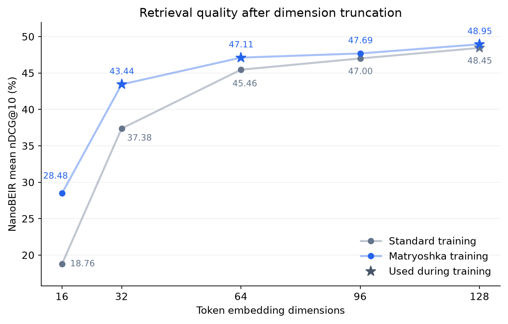

# Matryoshka Token Embeddings

In a multi-vector retrieval index, reducing each token embedding from 128 to 32 dimensions would cut its vector storage by 4x, but it can also discard information that makes the model good at search. [Matryoshka Representation Learning](https://huggingface.co/papers/2205.13147) teaches the leading dimensions to remain useful on their own, allowing a single encoder to retrieve at several embedding widths. Although the original work focuses on single-vector embeddings, the same principle applies to multi-vector encoders, especially when their default dimensionality is large.

Truncation keeps one embedding per token (unlike [token pooling](../token_pooling/README.md)) while reducing the dimensionality of every query and document vector. The encoder still runs its full backbone, with the smaller representations reducing embedding storage and the dimension of the dot products used in MaxSim scoring.

In my experience, token pooling preserves retrieval quality better at a similar reduction in vector storage, so try it before dimensionality reduction. If your token embeddings have much more than 128 dimensions, Matryoshka truncation may be a useful starting point though.

## Training

Ordinary retrieval training optimizes the full embedding, allowing useful information to spread across all of its dimensions. Simply discarding the last dimensions can therefore remove information needed to distinguish relevant documents from negatives. [`MultiVectorMatryoshkaLoss`](../../../../docs/package_reference/multi_vector_encoder/losses.html#multivectormatryoshkaloss) addresses this by evaluating the retrieval loss at several embedding widths during training, truncating and normalizing each query and document token vector before computing MaxSim scores.

In [training_cached_contrastive.py](training_cached_contrastive.py), the same batch contributes losses at 128, 64, and 32 dimensions, so the encoder learns to support all three widths jointly:

```python
from sentence_transformers import MultiVectorEncoder
from sentence_transformers.multi_vector_encoder.losses import (
    CachedMultiVectorMultipleNegativesRankingLoss,
    MultiVectorMatryoshkaLoss,
)

model = MultiVectorEncoder("answerdotai/ModernBERT-base")
loss = CachedMultiVectorMultipleNegativesRankingLoss(model, mini_batch_size=8)
loss = MultiVectorMatryoshkaLoss(
    model,
    loss,
    matryoshka_dims=[128, 64, 32],
    matryoshka_weights=[1 / 3] * 3,
)
```

`CachedMultiVectorMultipleNegativesRankingLoss` supplies the retrieval objective, teaching each query to score its relevant document above the negative documents in the batch. Its gradient caching lets the encoder process just 8 inputs at a time while each query is still compared with documents from all 256 training examples, reducing training memory without reducing the number of negatives.

`MultiVectorMatryoshkaLoss` wraps that objective and applies it at each selected embedding width, reusing the token embeddings without an additional encoder pass for each width. The only extra training work is truncation, normalization, and computing a retrieval loss at each width. With equal weights of `1/3`, the final loss is simply the average of the losses at 128, 64, and 32 dimensions. Set `matryoshka_dims` to include the model's full embedding width and the shorter widths you want to use.

The example script learns retrieval from MS MARCO triplets using `answerdotai/ModernBERT-base` with a fresh 128-dimensional token projection, although the same wrapper can fine-tune an existing retrieval model. Setting `query_expansion={"strategy": "min", "length": 32}` provides additional contextual query vectors by expanding short queries to at least 32 token positions, while longer queries retain their length up to the training token cap.

You can run the training script with or without the `--baseline` flag to compare the effect of the Matryoshka loss:

```bash
python -m examples.multi_vector_encoder.training.matryoshka.training_cached_contrastive --baseline
python -m examples.multi_vector_encoder.training.matryoshka.training_cached_contrastive
```

Both commands use the same initialization, data, and optimization settings, with `--baseline` changing only the loss. Small MS MARCO NanoBEIR evaluations track full and 32-dimensional retrieval alongside held-out validation loss, helping you check whether the shorter prefix is learning to retrieve. You can adapt the model, dimensions, and training settings directly in the script, keeping both runs matched when comparing losses. It saves the encoder under `models/<run_name>/final` and attempts a Hub upload using your `hf auth login` credentials.

## Applying Matryoshka-Style Truncation

Choose the embedding width when encoding queries and documents, using the example model from the Hub or the path to your own saved encoder:

```python
from sentence_transformers import MultiVectorEncoder

model = MultiVectorEncoder("tomaarsen/mve-ModernBERT-base-matryoshka")
query_embeddings = model.encode_query(["How can I make a retrieval index smaller?"], truncate_dim=32)
document_embeddings = model.encode_document(
    [
        "Matryoshka training preserves useful information in shorter prefixes of token embeddings.",
        "Paris is the capital of France.",
    ],
    truncate_dim=32,
)
print([embedding.shape for embedding in query_embeddings], [embedding.shape for embedding in document_embeddings])
# [torch.Size([32, 32])] [torch.Size([18, 32]), torch.Size([9, 32])]
scores = model.similarity(query_embeddings, document_embeddings)
print(scores)
# tensor([[19.2205, 10.5936]], device='cuda:0')
```

Passing `truncate_dim=32` to `encode`, `encode_query`, or `encode_document` keeps the first 32 coordinates of each token embedding and normalizes the resulting vector again. This normalization matters because slicing a unit-length vector generally changes its length, which would otherwise change the scale of its dot products. Use the same width for the document index and incoming queries so that MaxSim compares matching coordinates.

You can also initialize `MultiVectorEncoder` with `truncate_dim=32` to use that width by default. An explicit `truncate_dim` on an encode call overrides the model default, and saving the model preserves the default for subsequent loads.

## Evaluation Results

[evaluate_matryoshka.py](evaluate_matryoshka.py) compares full embeddings with 96, 64, 32, and 16 dimensions on all 13 NanoBEIR datasets. Running it on any multi-vector embedding model shows how much quality is retained at the width you intend to deploy, and you can edit the dimensions and evaluation settings to suit your model and use case. For example, you can compare the Matryoshka model with its baseline:

```bash
python -m examples.multi_vector_encoder.training.matryoshka.evaluate_matryoshka tomaarsen/mve-ModernBERT-base-matryoshka
python -m examples.multi_vector_encoder.training.matryoshka.evaluate_matryoshka tomaarsen/mve-ModernBERT-base-matryoshka-baseline
```

The comparison below uses matched training on 30,000 MS MARCO triplets with seed 42 and the final checkpoints. Scores are mean nDCG@10 (%) across the 13 NanoBEIR datasets, with storage measured at unchanged numeric precision and excluding other index structures.

| Dimensions | Vector storage | Ordinary model | Matryoshka model | Gain (points) |
| --- | --- | --- | --- | --- |
| 128 | 100.0% | 48.45 | 48.95 | +0.50 |
| 96 | 75.0% | 47.00 | 47.69 | +0.68 |
| 64 | 50.0% | 45.46 | 47.11 | +1.66 |
| 32 | 25.0% | 37.38 | 43.44 | +6.06 |
| 16 | 12.5% | 18.76 | 28.48 | +9.71 |



At 32 dimensions, Matryoshka improves retrieval from 37.38 to 43.44 while using one quarter of the vector storage. This retains 88.7% of the model's full-width nDCG@10, compared with 77.2% for the baseline, with each retention measured against that model's own full-width score. Training covered 128, 64, and 32 dimensions, while the evaluations at 16 and 96 dimensions show how well the model generalizes to widths it was not explicitly trained for.

## Combining Compression Techniques

For smaller indexes, consider these options in this order:

1. Quantization to 4, 2, or 1 bit, for example via [Fast-PLAID](https://github.com/lightonai/fast-plaid).
2. [Token pooling](../token_pooling/README.md) to reduce the number of document vectors, optionally with pooling-aware fine-tuning.
3. Matryoshka truncation, optionally with fine-tuning, to reduce each vector's dimensionality.

For models with much more than 128 dimensions, consider Matryoshka truncation and fine-tuning earlier. Wrap `MultiVectorMatryoshkaLoss` with `MultiVectorTokenPoolingLoss` to train for both smaller dimensions and fewer vectors, reusing encoder embeddings. Evaluate the final combination with your search engine and corpus.

## References

- [Matryoshka Representation Learning](https://huggingface.co/papers/2205.13147)
- [MultiVectorMatryoshkaLoss API](../../../../docs/package_reference/multi_vector_encoder/losses.html#multivectormatryoshkaloss)

## See Also

- [Token Pooling](../token_pooling/README.md)
- [Dense Matryoshka Embeddings](../../../sentence_transformer/training/matryoshka/README.md)
- [Fast-PLAID](https://github.com/lightonai/fast-plaid)
