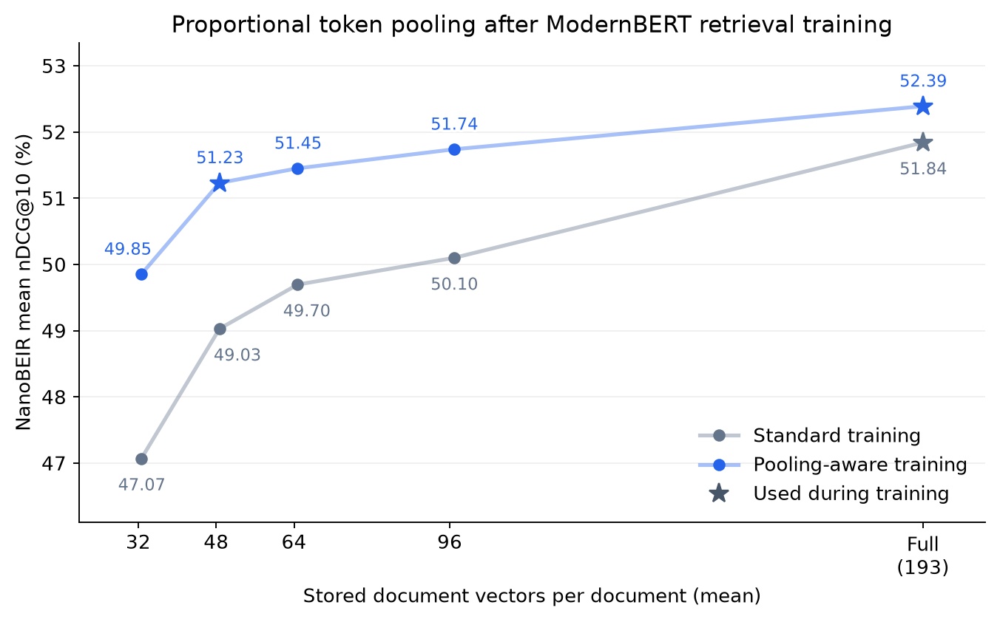

# Token Pooling-Aware Training

Token pooling merges similar token vectors to make multi-vector retrieval indexes smaller. Pooling-aware training teaches the encoder to preserve useful information when these vectors are merged, helping compressed representations remain effective for retrieval.

See the [Token Pooling-Aware Training blogpost](https://huggingface.co/blog/token-pooling) for a fuller explanation of the method and experiments.

## Token Pooling

`HierarchicalTokenPooling` groups similar token embeddings with Ward clustering and replaces each cluster with its normalized mean. Unlike [Matryoshka truncation](../matryoshka/README.md), which reduces each vector's dimensionality, pooling reduces the number of vectors. Queries remain unpooled by default. The encoder still runs its full backbone, with savings coming from storing and scoring fewer document vectors.

### Choosing a Pooling Budget

`HierarchicalTokenPooling` offers three alternative controls:

| Control | Effect | When to use it |
| --- | --- | --- |
| `max_tokens=16` | Keep at most 16 vectors, including protected tokens.<br>Shorter documents keep their existing vectors. | You want a per-document cap. |
| `pool_factor=4` | Keep approximately one quarter<br>of each document's vectors. | You want compression proportional<br>to document length. |
| `distance_threshold` | Merge up to a shared Ward distance threshold.<br>Vector counts depend on embedding geometry. | You want adaptive compression.<br>Calibrate it for an average vector budget. |

Configure one control at a time. By default, the first token is protected from merging, and all output vectors are normalized. Short documents can bring the average vector count below a fixed cap.

### Calibrating Adaptive Pooling

Adaptive pooling allocates vectors according to embedding geometry and can be useful without pooling-aware training. Rather than choosing a distance threshold manually, calibrate it for a target average vector count using a representative sample in `calibration_documents`:

```python
from sentence_transformers import MultiVectorEncoder
from sentence_transformers.multi_vector_encoder.modules import HierarchicalTokenPooling

model = MultiVectorEncoder("lightonai/LateOn")
calibration_embeddings = model.encode_document(calibration_documents)
threshold = HierarchicalTokenPooling.calibrate_distance_threshold(calibration_embeddings, target_tokens=16)
pooling = HierarchicalTokenPooling(distance_threshold=threshold)

# Apply pooling, targeting an average of 16 vectors per document
document_embeddings = model.encode_document(documents_to_index, token_pooling=pooling)
```

Calibration only needs document embeddings. Individual documents can receive more or fewer than 16 vectors, and the average can change on another corpus. Calibration returns `None` if the target requires no compression.

<details>
<summary>Matching the storage of a fixed cap</summary>

For a fair comparison, target the fixed cap's actual average count, which may be below its maximum:

```python
fixed_embeddings = HierarchicalTokenPooling(max_tokens=16).pool(calibration_embeddings)
target_tokens = sum(map(len, fixed_embeddings)) / len(fixed_embeddings)
threshold = HierarchicalTokenPooling.calibrate_distance_threshold(calibration_embeddings, target_tokens=target_tokens)
pooling = HierarchicalTokenPooling(distance_threshold=threshold)
```

The calibrated results below match each corpus's average counts under caps of 64, 32, and 16.
</details>

## Training

[training_cached_contrastive.py](training_cached_contrastive.py) averages an ordinary retrieval loss and a loss using approximately one quarter of each document's vectors:

```python
from sentence_transformers import MultiVectorEncoder
from sentence_transformers.multi_vector_encoder.losses import (
    CachedMultiVectorMultipleNegativesRankingLoss,
    MultiVectorTokenPoolingLoss,
)
from sentence_transformers.multi_vector_encoder.modules import HierarchicalTokenPooling

model = MultiVectorEncoder("answerdotai/ModernBERT-base")
pooling = HierarchicalTokenPooling(pool_factor=4)
loss = CachedMultiVectorMultipleNegativesRankingLoss(model, mini_batch_size=64)
loss = MultiVectorTokenPoolingLoss(
    model,
    loss,
    token_poolings=[None, pooling],
    weights=[0.5, 0.5],
)
```

`CachedMultiVectorMultipleNegativesRankingLoss` teaches each query to score its relevant document above negatives. Gradient caching processes 64 inputs at a time while comparing each query with documents from all 256 training examples.

[`MultiVectorTokenPoolingLoss`](../../../../docs/package_reference/multi_vector_encoder/losses.html#multivectortokenpoolingloss) applies that objective to each entry in `token_poolings`. Here, `None` uses the original embeddings and `pooling` supplies the factor-4 variant. The weights average their losses. Variants reuse the encoder's embeddings, adding clustering and scoring work without a separate encoder pass per pooler.

Custom `BaseTokenPooling` implementations can be used if they preserve gradients through the input embeddings. `HierarchicalTokenPooling` uses a straight-through estimator to pass gradients back to cluster members without differentiating Ward's discrete assignments.

The script starts from `answerdotai/ModernBERT-base` with a fresh 128-dimensional projection. Short queries are expanded to at least 32 token positions to provide additional contextual query vectors. You can also fine-tune an existing retrieval model or replace the factor-4 pooler with your deployment configuration.

Run both variants for a matched comparison:

```bash
python -m examples.multi_vector_encoder.training.token_pooling.training_cached_contrastive --baseline
python -m examples.multi_vector_encoder.training.token_pooling.training_cached_contrastive
```

`--baseline` changes only the loss, keeping initialization, data, and optimization settings matched. MS MARCO NanoBEIR evaluations track unpooled and factor-4 retrieval alongside validation loss during training. Edit the script to adapt the setup. It saves the final encoder and attempts a Hub upload using your `hf auth login` credentials.

## Using the Trained Model

Pass the pooler when encoding documents:

```python
from sentence_transformers import MultiVectorEncoder
from sentence_transformers.multi_vector_encoder.modules import HierarchicalTokenPooling

model = MultiVectorEncoder("tomaarsen/mve-ModernBERT-base-token-pooling")
pooling = HierarchicalTokenPooling(pool_factor=4)

queries = ["Which planet is known as the Red Planet?"]
documents = [
    "Venus is often called Earth's twin because of its similar size and proximity.",
    "Mars, known for its reddish appearance, is often referred to as the Red Planet.",
    "Jupiter, the largest planet in our solar system, has a prominent red spot.",
]

query_embeddings = model.encode_query(queries)
document_embeddings = model.encode_document(documents, token_pooling=pooling)

print([len(embedding) for embedding in document_embeddings])
# [5, 6, 5]
print(model.similarity(query_embeddings, document_embeddings))
# tensor([[16.0037, 25.9879, 22.8159]], device='cuda:0')

# For comparison, the same model without token pooling:
# [18, 21, 19]
# tensor([[16.6115, 27.6060, 24.1766]], device='cuda:0')
```

Pooling reduces the total from 58 vectors to 16 while preserving the ranking: Mars scores highest, followed by Jupiter and Venus. Query embeddings remain unchanged.

You can change the pooling configuration at inference. For repeated use, pass `token_pooling=pooling` to the `MultiVectorEncoder` constructor to make it the runtime default, with the pooler's `tasks` controlling which inputs are compressed.

## Evaluation Results

[evaluate_token_pooling.py](evaluate_token_pooling.py) evaluates any multi-vector model on all 13 NanoBEIR datasets, using unpooled retrieval, caps of 64, 32, 16, 8, and 4 vectors, and pool factors of 2 through 6. Edit the settings to explore your deployment budget:

```bash
python -m examples.multi_vector_encoder.training.token_pooling.evaluate_token_pooling tomaarsen/mve-ModernBERT-base-token-pooling
python -m examples.multi_vector_encoder.training.token_pooling.evaluate_token_pooling tomaarsen/mve-ModernBERT-base-token-pooling-baseline
```

Both models below were trained on the same 120,000 MS MARCO triplets with seed 42, changing only the loss. Scores are mean nDCG@10 (%) with FP32 inference. Mean vectors is the average number of document vectors across the evaluation corpora, at unchanged dimensionality and precision.

| Pooling at inference | Mean vectors | Ordinary model | Pooling-aware model | Gain (points) |
| --- | ---: | ---: | ---: | ---: |
| Unpooled | 193.22 | 51.84 | 52.39 | +0.55 |
| `pool_factor=2` | 96.86 | 50.10 | 51.74 | +1.64 |
| `pool_factor=3` | 64.74 | 49.70 | 51.45 | +1.76 |
| `pool_factor=4` | 48.68 | 49.03 | 51.23 | +2.20 |
| `pool_factor=5` | 39.04 | 48.13 | 50.28 | +2.15 |
| `pool_factor=6` | 32.62 | 47.07 | 49.85 | +2.78 |
| `max_tokens=64` | 54.76 | 49.27 | 50.89 | +1.63 |
| `max_tokens=32` | 29.58 | 48.25 | 50.12 | +1.87 |
| `max_tokens=16` | 15.60 | 46.61 | 49.26 | +2.65 |
| `max_tokens=8` | 7.99 | 43.12 | 46.61 | +3.48 |
| `max_tokens=4` | 4.00 | 37.22 | 43.00 | +5.78 |
| `distance_threshold` (calibrated) | 54.76 | 50.10 | 51.24 | +1.14 |
| `distance_threshold` (calibrated) | 29.58 | 48.38 | 50.96 | +2.58 |
| `distance_threshold` (calibrated) | 15.60 | 47.23 | 49.63 | +2.41 |



At the trained `pool_factor=4`, pooling-aware training improves nDCG@10 from 49.03 to 51.23 with a 4-fold reduction in document vectors relative to unpooled retrieval. Score retention rises from 94.6% to 97.8%, measured against each model's own unpooled mean nDCG@10.

The gains transfer to other settings. Adaptive pooling at 29.58 vectors per document retains 97.3% of the pooling-aware model's unpooled score while storing 84.7% fewer vectors. Each calibrated threshold is shared across its corpus and matches the average storage of the corresponding fixed cap.

These are illustrative models with room for stronger training recipes, as the `MultiVectorTokenPoolingLoss` loss wrapper can wrap any multi-vector loss.

## Combining Compression Techniques

For smaller indexes, consider these options in this order:

1. Quantization to 4, 2, or 1 bit, for example via [Fast-PLAID](https://github.com/lightonai/fast-plaid).
2. Token pooling, optionally with pooling-aware fine-tuning.
3. [Matryoshka token embeddings](../matryoshka/README.md), optionally with fine-tuning, to reduce each vector's dimensionality.

For models with more than 128 dimensions, consider Matryoshka truncation and fine-tuning earlier. Wrap `MultiVectorMatryoshkaLoss` with `MultiVectorTokenPoolingLoss` to train for both smaller dimensions and fewer vectors, reusing encoder embeddings. Just be sure to evaluate the final combination with your search engine and corpus.

## References

- [Learn to Pool](https://stefan-jo.github.io/learn-to-pool)
- [LightOn's pooling regularization study](https://huggingface.co/blog/lightonai/lateon-hpool-regularization)
- [MultiVectorTokenPoolingLoss API](../../../../docs/package_reference/multi_vector_encoder/losses.html#multivectortokenpoolingloss)

## See also

- [Matryoshka training](../matryoshka/README.md)
- [Fast-PLAID (index quantization)](https://github.com/lightonai/fast-plaid)
